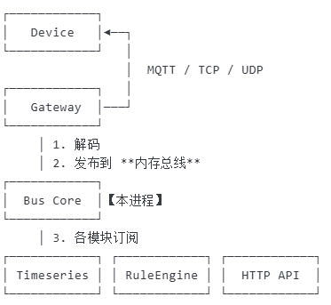

零外部依赖的内存消息总线， 生产环境建议基于kafka等消息中间件实现：

上下行消息topic : 

| 方向     | Topic 模板                      | 示例                      | 通配订阅                     |
| ------ | ----------------------------- | ----------------------- | ------------------------ |
| **上行** | `iot/up/<product>/<device>`   | `iot/up/ac001/dev123`   | `iot/up/+/+` 看全部         |
| **下行** | `iot/down/<product>/<device>` | `iot/down/ac001/dev123` | `iot/down/ac001/+` 只给该产品 |

